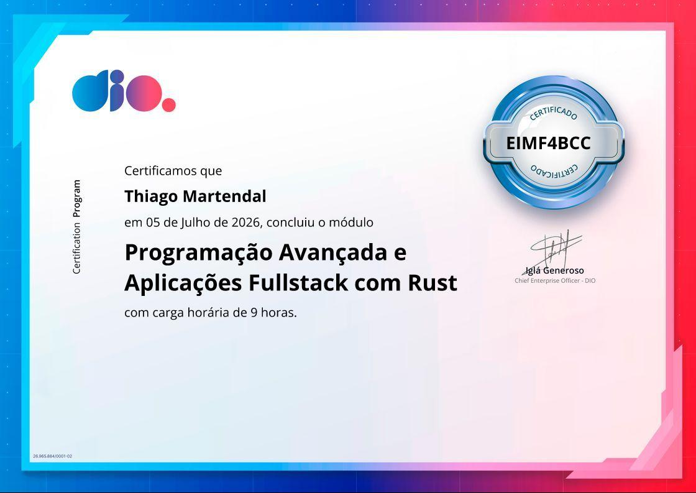

# Bootcamp Rust DIO

Estão disponíveis os arquivos e códigos desenvolvidos durante o bootcamp de rust pela DIO.

O projeto final do bootcamp está disponível no repositório [deste link](https://github.com/thiagomartendal/Carteira-de-Investimentos).

